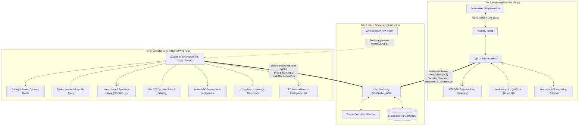
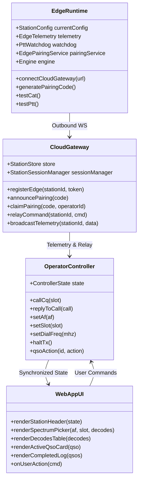
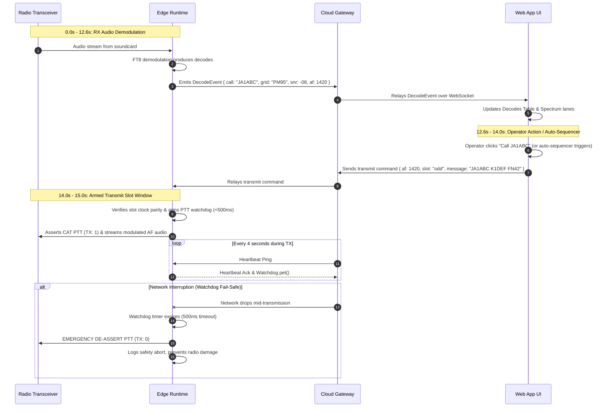
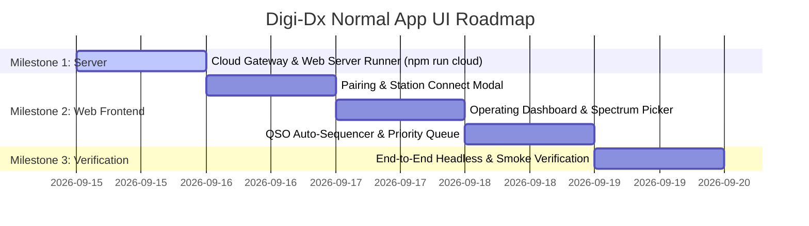

# Digi-Dx System Architecture & Design Document
**Architecture: Edge Radio Daemon, Cloud Gateway, and Unified Web App**
**Status:** Living Design Document (September 2026)

---

## 1. Executive Summary & Vision

Traditional digital mode software (e.g., WSJT-X, JTDX) bundles radio CAT control, soundcard DSP, contact sequencing logic, and user interface into a monolithic desktop application. This design forces operators to physically sit at their radio bench, while presenting complex, cluttered interfaces with flat unranked decode feeds.

**Digi-Dx** splits this architecture into three clean, focused layers:

1. **Unitary Edge Client:** A lean daemon running on the radio-connected machine (Raspberry Pi, Linux PC, Mac). It handles soundcard audio I/O, transceiver CAT/PTT control, FT8 DSP modulation/demodulation, a local diagnostics dashboard (GUI/TUI), and an autonomous 500ms hardware PTT fail-safe watchdog.
2. **Cloud Gateway & Station Coordinator:** A lightweight service (running in the cloud or locally) responsible for station pairing via ephemeral 6-digit PINs, single-operator transmitter exclusivity enforcement, telemetry persistence, and low-latency bidirectional command routing.
3. **Unified Web App (Standard App UI):** A responsive, intuitive web application accessible from any browser (desktop, tablet, or phone). It gives the operator full FT8 operating capabilities: live band decodes, interactive audio frequency picker, priority caller queueing, automatic/manual QSO sequencing, and ADIF logging.

*(Note: Agentic UI customization has been intentionally deferred until the standard web application and edge-to-cloud operating flows are completely established and battle-tested.)*

---

## 2. System Topology & Physical Boundaries



### Physical Tier Responsibilities

| Tier | Host | Key Components | Network Exits |
| :--- | :--- | :--- | :--- |
| **Tier 1: Edge** | Raspberry Pi / Radio PC | Audio DSP, Hamlib CAT, PTT Watchdog, Local GUI/TUI, Pairing Service | Only **one outbound** WebSocket connection to Cloud Gateway. Zero inbound router ports required. |
| **Tier 2: Cloud** | Cloud Server (or Localhost) | Cloud Gateway WS server, Session Exclusivity, SQLite/JSON Store, Web Server | Standard HTTP & WebSocket endpoints. |
| **Tier 3: Web App** | Laptop, Phone, Tablet | Dedicated Web App: Decodes table, AF picker, QSO sequencer, TX controls | Single WebSocket connection to Cloud Gateway. |

---

## 3. Subsystem Architecture & Responsibilities



### 3.1 Tier 1: Unitary Edge Client (`src/edge/`) — *Built & Verified*
- **5 Diagnostic Pillars:** Continuously monitored and displayed on local GUI (`http://localhost:8792`) and terminal TUI:
  1. *Program & Watchdog:* Process health, uptime, engine status.
  2. *Config Setup:* Callsign, grid square, audio soundcard ID, CAT serial port.
  3. *Cloud Communication:* Pairing status (Unpaired / Pairing / Paired), ping latency, heartbeat ack.
  4. *Radio CAT:* Live dial frequency, CAT communication health, PTT state.
  5. *FT8 Engine & DSP:* Even/odd slot clock, countdown seconds, decode counter, SNR.
- **PTT Hardware Watchdog (`watchdog.ts`):** Operates on a strict 500ms sliding timer. Every transmission requires active heartbeat pings from the control stream. If the network drops for >500ms, the watchdog de-asserts PTT immediately to protect radio amplifiers.
- **Ephemeral Pairing Service (`pairing.ts`):** Generates a random 6-digit numeric PIN (expires in 5 minutes). Transmits pairing code to Cloud Gateway. Once claimed in the web app, permanent cryptographic session tokens are exchanged.

### 3.2 Tier 2: Cloud Gateway & Station Coordinator (`src/cloud/`)
- **Cloud Gateway (`gateway.ts`):** Multiplexes inbound connections from Edge daemons and Web browser clients. Translates FT8 decodes, slot clock ticks, and transmit intents.
- **Session Exclusivity Manager (`session.ts`):** Radio regulations require single-operator transmitter control. The manager grants exclusive TX control to one operator session while allowing secondary connections in read-only "monitor" mode.
- **Station Store (`store.ts`):** Persists station settings, decode history, and completed QSO logs (ADIF format).
- **Web App Host:** Serves static frontend assets (HTML, CSS, JS) over HTTP.

### 3.3 Tier 3: Unified Web App UI (`ui/web/` / Browser)
- **Pairing & Station Connect:** Operators enter the 6-digit pairing code shown on their Edge client's local GUI or TUI. Once verified, the web client receives an auth token and automatically reconnects in future sessions.
- **Operating Dashboard:**
  - **Station Banner:** Callsign, Maidenhead grid, dial frequency, CAT status, and live 15-second FT8 slot clock countdown.
  - **AF Spectrum Picker:** Visual 200–3000 Hz spectrum with separate EVEN and ODD lanes showing current band activity and allowing 1-click TX audio frequency selection.
  - **Live Decodes Stream:** Chronological and searchable decode table with SNR, DT, frequency, callsign, and grid. Responders to the operator's CQ are highlighted.
  - **Active QSO & Auto-Sequencer:** Call CQ, manage staged callers in a priority queue, and progress automatically through FT8 sequence states (Report -> RRR/RR73 -> 73).
  - **Completed Log & ADIF Export:** Visual log of completed contacts with 1-click ADIF export.
  - **Transmitter Controls & Safety:** TX enable toggle, live TX status banner (Idle / Armed / Transmitting), and an instant **Emergency Halt** button.

---

## 4. Key Sequence Flows

### Flow 1: Edge-to-Cloud Pairing Handshake
How an operator connects a newly installed edge client to their web browser.

```mermaid
sequenceDiagram
    autonumber
    actor Op as Operator
    participant Edge as Edge Client (Pi/PC)
    participant Cloud as Cloud Gateway
    participant Web as Web App (Browser)

    Op->>Edge: Launches edge client (`npm run edge`)
    Edge->>Edge: Generates 6-digit pairing code (e.g. "849201")
    Edge->>Edge: Displays code on Local GUI (:8792) and Blessed TUI
    Edge->>Cloud: Connects WS & announces { type: "edge_pairing_code", code: "849201" }
    
    Op->>Web: Navigates to Web App in browser (`http://localhost:8080`)
    Op->>Web: Enters 6-digit code "849201" in Connect dialog
    Web->>Cloud: Sends { type: "claim_pairing", code: "849201" }
    Cloud->>Cloud: Validates code & generates Session Auth Token
    Cloud-->>Web: Returns { type: "pairing_claimed", token: "tok_abc123" }
    Cloud-->>Edge: Emits { type: "pairing_complete", token: "tok_abc123" }
    Edge->>Edge: Saves token to config; status updates to "Paired & Connected"
    Web->>Cloud: Opens authenticated control stream with token
    Cloud-->>Web: Streams live station status, decodes, and slot clock
```

### Flow 2: 15-Second FT8 Slot Operating & Fail-Safe Transmit
The real-time cycle of decoding, sequencing, transmitting, and fail-safe watchdog protection.



---

## 5. Implementation Roadmap: Building the Web App Experience

With the **Unitary Edge Client** complete and tested, the immediate implementation roadmap focuses on establishing the end-to-end operating loop:



### Next Immediate Deliverables:

1. **Step 1: Cloud Gateway & Web Server Runner (`scripts/cloud.ts` / `npm run cloud`)**
   - Start `CloudGateway` WebSocket server on port `8795`.
   - Start an HTTP server hosting the web application on port `8080`.
   - Add `npm run cloud` script to `package.json`.
   - *Result:* The Edge Client's `ECONNREFUSED 127.0.0.1:8795` log is immediately resolved, connecting the edge daemon to a live gateway.

2. **Step 2: Pairing & Connection Flow in Web App**
   - Implement the 6-digit pairing code modal in the web app:
     - When the operator opens the web app without an active session, prompt: *"Enter the 6-digit code shown on your radio machine"*.
     - Claim pairing via `claim_pairing`, save the session auth token in `localStorage`, and transition to the live operating view.

3. **Step 3: Operating Dashboard & QSO Sequencer**
   - Wire the web interface to the real-time telemetry feed:
     - Live 15-second FT8 slot clock countdown and even/odd parity indicator.
     - Dual-lane AF spectrum picker (200–3000 Hz) showing active decodes and allowing 1-click TX frequency selection.
     - Decodes table with click-to-call, search, and SNR highlights.
     - Active QSO card with automated state transitions (CQ -> Report -> RR73 -> 73) and manual override.
     - Emergency halt button and TX enable/disable toggle.

4. **Step 4: End-to-End Verification**
   - Run simulated end-to-end QSO verification: Edge Client in demo mode (`--sim`) + Cloud Gateway + Web App, proving a complete QSO from pairing to completion.
