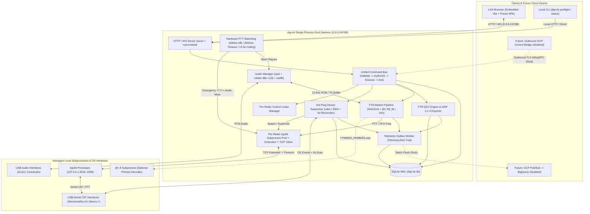
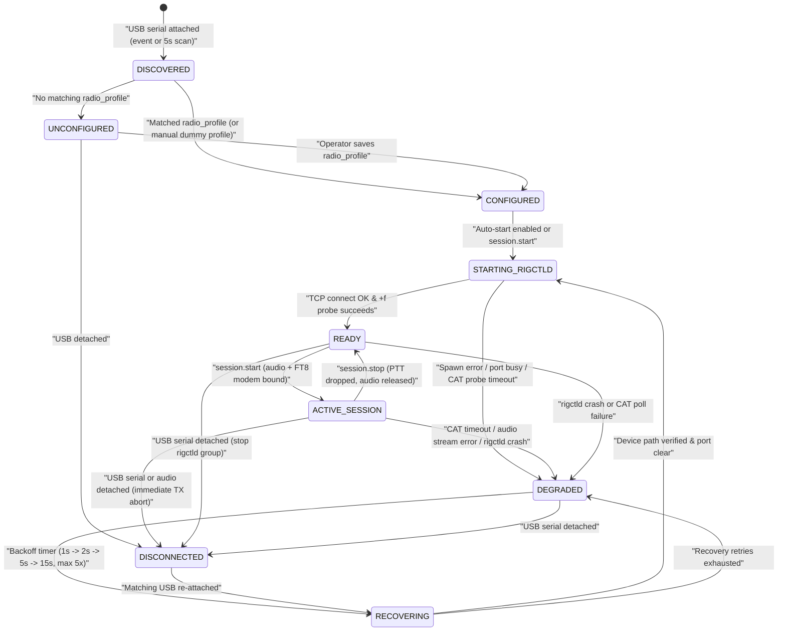
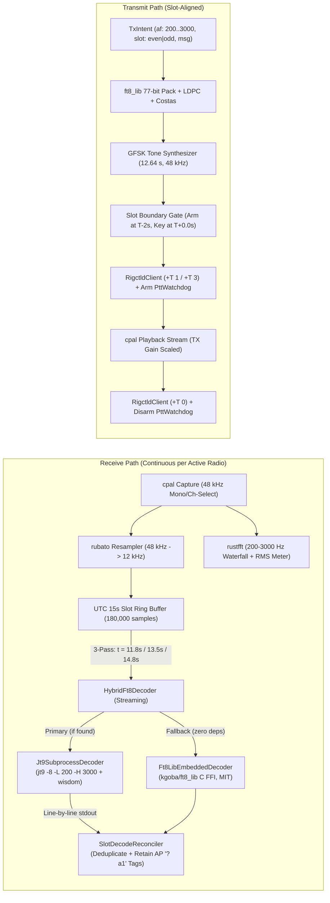
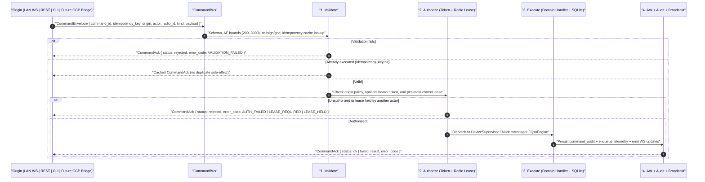

# Digi-Dx v2 System Architecture

**Status:** Design Specification (v2.0 Ground-Up Rebuild)
**Reference Context:** Incorporates validated hardware findings and traps from [`docs/legacy-domain-notes.md`](legacy-domain-notes.md).
**Companion Specs:** [`docs/deployment-and-deps.md`](deployment-and-deps.md) · [`docs/mvp-spec.md`](mvp-spec.md)

---

## 1. Architectural Vision & Design Principles

Digi-Dx v2 is a **single-process, locally hosted FT8 operating daemon** with an embedded LAN web UI, designed from the ground up for unattended reliability on radio-attached Linux (x86_64 & Raspberry Pi 4/5 `aarch64`) and macOS (Apple Silicon & Intel) hosts.

Core design principles:
1. **Single Native Binary, Zero Interpreted Runtime Baggage:** One Rust executable (`digi-dx`) embeds the compiled web UI (`rust-embed`), manages local SQLite state (`WAL` mode), owns soundcard PCM audio (`cpal`), supervises per-radio `rigctld` subprocesses, and executes FT8 encode/decode directly.
2. **Retire Brittle v1 Glue (`ft8cat` / `ft8modem` / `rtaudio` / Python3):** By moving audio I/O, 15-second UTC slot framing, GFSK transmit modulation, and direct Hamlib `rigctld` TCP control into the Rust daemon, v2 achieves full Linux + macOS parity and eliminates every v1 `ft8cat`/`ft8modem` quirk documented in [`docs/legacy-domain-notes.md`](legacy-domain-notes.md) (`-F` silent decode-logging bug, `-m` flag trap, exit-code-1 device discovery, unstable numeric ALSA IDs, and source compilation of `rtaudio 6.0.1`).
3. **Permissive License Hygiene (MIT / Apache-2.0):** The Rust codebase links only permissive/weak-copyleft crates (`MIT`, `Apache-2.0`, `MPL-2.0`). GPLv3 reference binaries (`rigctld`, `jt9`) are invoked strictly across OS process/TCP boundaries.
4. **Hardware-First Safety & Multi-Radio Awareness:** USB/serial transceivers are hot-plug discovered and indexed by persistent OS paths and hardware identity, supervised via an explicit lifecycle state machine, and protected by an autonomous PTT hardware watchdog.
5. **Cloud-Ready by Interface, Local-First in Operation:** GCP telemetry ingestion and outbound remote control are designed as clean internal seams (local SQLite outbox + unified Command Bus) with stubbed implementations in MVP—requiring zero internet access or inbound firewall ports to operate.

---

## 2. System Diagram



---

## 3. Tech Stack Justification & License Audit

### 3.1 Core Rust Daemon Crates

| Concern | Chosen Crate / Tech | License | Rationale |
| :--- | :--- | :--- | :--- |
| **Async Runtime** | `tokio` (multi-threaded) | MIT | Standard Rust async runtime for concurrent WebSocket fan-out, subprocess supervision, TCP CAT I/O, and timers. |
| **HTTP / WebSocket** | `axum` + `tower-http` | MIT | Ergonomic typed routing, WebSocket upgrade support, static asset serving, CORS/auth middleware. |
| **Embedded Web UI** | `rust-embed` | MIT | Compiles `ui/dist/` directly into the Rust binary; single-artifact deployment on Linux and macOS. |
| **Local Persistence** | `rusqlite` (`bundled` feature) | MIT | Compiles SQLite directly into the binary (zero host `libsqlite3` drift), supports `WAL` mode, synchronous transactions for the local outbox, and strict `0600` file permissions. |
| **Cross-Platform Audio** | `cpal` | Apache-2.0 | Native ALSA backend on Linux and CoreAudio backend on macOS without requiring C++ `rtaudio` compilation. |
| **Resampling & Waterfall** | `rubato` + `rustfft` | MIT / Apache-2.0 | Clean `48 kHz ↔ 12 kHz` resampling for FT8 DSP plus real-time passband FFT spectrum/occupancy bins (`200–3000 Hz`). |
| **Embedded FT8 Fallback & TX** | `kgoba/ft8_lib` (vendored C via `cc` crate in `build.rs`) | MIT | Compiles cleanly with zero external runtime deps; provides 77-bit FT8 message packing, LDPC/Costas encoding, GFSK waveform synthesis, and built-in zero-dep FT8 decode fallback. |
| **High-Sensitivity FT8 Decode** | External `jt9` subprocess (`WSJT-X`) | GPLv3 (external process) | Delivers gold-standard WSJT-X weak-signal sensitivity (~`-24 dB`, multi-pass subtraction, AP decoding) without linking GPLv3 code into Digi-Dx. |
| **CAT Rig Control** | External `rigctld` subprocesses (`Hamlib`) | LGPL/GPL (external process) | Supports 250+ amateur transceivers; isolated per-radio via loopback TCP (`+` extended response protocol). |
| **Hot-Plug USB Discovery** | `nusb` (cross-platform) + `udev` (Linux-only `cfg`) + `serialport` | MIT / Apache-2.0 / MPL-2.0 | `nusb::watch_devices()` monitors OS USB attach/detach on Linux & macOS without detaching kernel serial drivers; Linux `udev` crate watches `tty`/`sound` events after symlink creation; `serialport` enumerates `/dev/cu.*` and USB descriptors on macOS. |
| **Structured Logging & IDs** | `tracing` + `tracing-subscriber` + `uuid` (v7) | MIT / Apache-2.0 | JSON/pretty logs for `journald` and `launchd`, plus time-ordered UUIDv7 IDs for telemetry outbox events and command idempotency. |

### 3.2 Embedded Frontend Stack
- **Vite + TypeScript + Preact** (built to static files in `ui/dist/` and embedded via `rust-embed`).
- **Why Preact over heavier frameworks:** React-compatible component/hook ergonomics with minimal gzipped bundle size (~4–15 KB runtime), keeping the embedded Rust binary lean and responsive on mobile browsers over shack Wi-Fi. *(React compatibility remains trivial via `preact/compat` if larger React component libraries are ever needed.)*
- **Zero browser slot-clock duplication:** Following the v1 lesson from [`docs/legacy-domain-notes.md`](legacy-domain-notes.md), the daemon is the sole timing authority; the SPA renders countdowns from server-published `SlotClockSpec` anchor timestamps and never runs independent TX scheduling timers.

---

## 4. Component Boundaries & Responsibilities

### 4.1 Hot-Plug Device Supervisor (`DeviceSupervisor`)
Responsible for discovering physical USB-serial and USB-audio hardware dynamically—including devices plugged in *after* the daemon is already running—binding them to saved `radio_profiles`, and supervising per-radio `rigctld` processes.

#### Dual-Trigger Discovery (OS Events + Reconciliation Loop)
1. **OS Event Trigger (Low Latency):**
   - **Linux:** `udev` netlink monitor subscribed to `tty` and `sound` subsystems (fires *after* `udev` finishes applying `99-digi-dx.rules` and creating `/dev/serial/by-id/*` symlinks), supplemented by `nusb::watch_devices()`.
   - **macOS:** `nusb::watch_devices()` (IOKit `IOUSBDevice` arrival/removal notifications).
   - Events pass through a **`250 ms` trailing debounce** before invoking `reconcile_devices()`, ensuring kernel driver binding and symlink creation settle before probing.
2. **Periodic Reconciliation Loop (Self-Healing Safety Net):**
   - Runs every **`5 seconds`** regardless of OS events.
   - Enumerates current OS serial nodes + sysfs/IOKit USB metadata + `cpal` audio devices, diffs against `usb_devices` in SQLite and active in-memory `RadioSupervisor` handles, and repairs any missed hot-plug or zombie subprocess state.

#### Persistent Hardware Indexing (Eliminating `/dev/ttyUSB*` & Numeric ALSA ID Drift)
- **Serial CAT Identity Key:**
  - Primary persistent path: `/dev/serial/by-id/<symlink>` on Linux; `/dev/cu.<name>` paired with IOKit USB location/serial on macOS.
  - Hardware fingerprint tuple: `(usb_vid, usb_pid, usb_serial, usb_interface_num)` (e.g., `0403:6001:AB0C1234:00`).
  - Matching precedence when a configured radio reconnects:
    1. Exact match on `serial_by_id_path` (Linux) or `(vid, pid, serial, interface)`.
    2. If `usb_serial` is absent (common on generic CH340/Prolific adapters), match by `(vid, pid, usb_port_topology_path, interface)` and emit a `WARN` event recommending a unique adapter or fixed USB hub port.
    3. Never auto-bind a profile to a different `(vid, pid)` or silently swap two identical adapters without serial numbers; transition to `DEGRADED` with an explicit operator re-bind prompt.
- **Audio Device Identity Key:**
  - v1 stored numeric RtAudio/ALSA IDs (e.g., `141`) that silently shifted on reboot/replug.
  - v2 indexes audio interfaces by:
    - **Linux:** ALSA card long name + sysfs USB bus/port path (`/sys/class/sound/cardN/device`) + `(usb_vid, usb_pid, usb_serial)` when USB-backed (e.g., SignaLink USB TI PCM290x `08bb:2900` → `USB Audio CODEC`).
    - **macOS:** CoreAudio persistent device UID + device name.
  - Startup verifies both capture (`inputs >= 1`) and playback (`outputs >= 1`) support `48000 Hz` (or an accepted resamplable rate). If matched only by name fallback rather than exact USB/UID key, emit a non-fatal `WARN` telemetry event.

#### Per-Radio `rigctld` Lifecycle State Machine

Each discovered or configured radio runs an independent supervisor task on its own state machine and allocated loopback TCP port (`127.0.0.1:4532`..`4599`, persisted in `radio_profiles.rigctld_port`):



#### `rigctld` Process & Protocol Discipline
- **Per-Radio Spawn Arguments:**
  - Real transceiver: `rigctld -m <hamlib_model> -r <persistent_device_path> -s <baud_rate> -t <loopback_port> -T 127.0.0.1 [optional -c <civ_addr>] [optional -P <ptt_type> -p <ptt_path>] [optional -C key=val ...]`
  - Dummy transceiver (testing / no-CAT mode, per [`docs/legacy-domain-notes.md`](legacy-domain-notes.md)): `rigctld -m 1 -t <loopback_port> -T 127.0.0.1`.
- **Extended Response Protocol (`+` Prefix):** All CAT commands use Hamlib's structured extended protocol so responses return explicit `Key: Value` pairs terminated by `RPRT <code>` (`0` = OK, negative = Hamlib error code):
  - `+f` (`get_freq`) / `+F <hz>` (`set_freq`)
  - `+m` (`get_mode`) / `+M <mode> <passband_hz>` (`set_mode`, e.g., `USB 2400` or `PKTUSB 0`)
  - `+t` (`get_ptt`) / `+T <0|1|3>` (`set_ptt`: `0` = RX, `1` = TX CAT, `3` = TX Data)
- **Single-Client TCP Multiplexer (Fixing v1 Contention):** Exactly one `RigctldClient` task holds a persistent TCP connection to each radio's `rigctld` port and serializes all polling (`get_freq`/`get_mode` every `2 s` during RX, paused during TX) and commands (`set_ptt`, `set_freq`, `test_cat`, `test_ptt`) through an mpsc channel. Diagnostic tests never open a competing socket.
- **Clean Process-Group Teardown:** Spawn every `rigctld` (and `jt9`) in its own POSIX process group (`setsid`/`setpgid`) with `kill_on_drop(true)`. On stop or disconnect: send `+T 0` best-effort (`300 ms`), send `SIGTERM` to `-pgid`, escalate to `SIGKILL` after `5000 ms`.

---

### 4.2 Hybrid FT8 Audio & DSP Pipeline (`AudioManager` + `ModemManager`)



#### Key DSP & Timing Invariants (Preserved from v1)
- **Authoritative `SlotClock`:**
  - Four-field spec: `{ epoch_ms, anchor_wall_ms, slot_ms: 15_000, scale: 1.0 }`.
  - Live radios always run at `scale = 1.0` anchored to UTC wall time.
  - Strict newtype separation in Rust (`UnixSecs(i64)` vs `VirtualMs(i64)`) makes v1's seconds-vs-milliseconds parity/timestamp trap a **compile-time error**.
  - Slot parity: `(unix_secs / 15) % 2 == 0` → `even`, else `odd`.
  - Automation arms transmit `2` virtual seconds before the slot boundary with a `50 ms` minimum wall-delay floor (scale validated at `SlotClock::new` so `scale <= slot_ms / (2 * floor_ms)`).
- **`jt9` Subprocess Adapter & Multi-Pass Early Decoding:**
  - Runs a WSJT-X-style 3-stage pipeline per RX slot using non-destructive buffer snapshots (`snapshot_slot_samples()`, padded to `15.0 s`) and exact boundary rollover (`reset_for_new_slot()`):
    - **Pass 1 (`t = 11.8 s`, `-d 1`):** Fast early pass (`-w 0` if wisdom not yet cached) delivering ~80–85% of signals ~3 s before slot close.
    - **Pass 2 (`t = 13.5 s`, `-d 2`):** Normal pre-close pass catching weaker/later signals before TX scheduling.
    - **Pass 3 (`t = 14.8 s`, `-d 3`):** Deep final pass continuing up to `+300 ms` grace before TX (and asynchronously past TX start if still scanning deep candidates).
  - Writes each WAV strictly as **`YYMMDD_HHMMSS.wav`** in a per-run `-t` tempdir while caching FFTW3 plans (`jt9_wisdom.dat`) in persistent `-a <data_dir>/jt9` and bounding the search passband (`-L 200 -H 3000`).
  - Streams `jt9` stdout line-by-line as decoded rather than waiting for process exit.
  - `SlotDecodeReconciler` reconciles lines across passes by `(slot_ts, clean_message, |ΔAF| <= 15 Hz)` without duplicates, upgrades confidence (`? a1` → `a1` → verified CRC) without downgrading earlier verified decodes, retains `decoder_metadata` for UI visibility, and flushes `ft8.decode` telemetry once per slot.
- **Built-In `ft8_lib` Fallback & UI Visibility:**
  - If `jt9` is absent or fails preflight arch verification, `ModemManager` seamlessly uses `Ft8LibEmbeddedDecoder` (`kgoba/ft8_lib`, MIT) and surfaces `decoder_backend: "ft8_lib_fallback"` in `status` and UI banner so the operator always knows whether WSJT-X reference sensitivity or built-in fallback is active.
- **`SimulatedModem` (Demo & CI Verification):**
  - Implements the exact same modem boundary without opening audio devices or spawning `rigctld`/`jt9`.
  - Uses ITU non-assignable `QQ*` callsigns (`QQ0DEMO` for local station, seeded `QQ0..9XXX` band roster), `scale = 1.0` for interactive demo, and `scale > 1.0` (e.g., `20.0`) only for headless CI QSO verification.
  - Demo sessions can never overwrite persisted `station_config` or `radio_profiles`, and demo QSOs write exclusively to `demo_qso_log` (never `qso_log` or ADIF exports).

#### Hardware PTT Safety (`PttWatchdog`)
Three independent fail-safe layers protect transceivers and amplifiers:
1. **Operator Lease Heartbeat Watchdog:** When TX is armed or active by a remote/LAN client, the client sends `control.heartbeat` every **`500 ms`**; `PttWatchdog` timeout is **`2000 ms`** (`heartbeat_interval < watchdog_timeout`, explicitly preventing v1's `4000 ms` heartbeat vs `500 ms` timeout bug). On timeout or WebSocket disconnect, `PttWatchdog` immediately aborts `cpal` playout and issues `+T 0` to `rigctld`.
2. **Hard FT8 TX Duration Ceiling:** Regardless of heartbeats, an independent monotonic timer forcibly cuts audio and sends `+T 0` if physical PTT stays asserted past **`13.5 seconds`** (FT8 active waveform is `12.64 s`).
3. **Hot-Plug & Crash Fail-Safe:** USB detach, audio stream callback error, or daemon `SIGINT`/`SIGTERM` triggers immediate audio mute + best-effort `+T 0` before closing `rigctld`.

---

### 4.3 Daemon-Side FT8 QSO Engine (`QsoEngine`)
Unlike v1 (where QSO automation initially drifted between TUI and Web clients before being refactored into `OperatorController`), v2 places `QsoEngine` directly inside the single-process daemon so all LAN browsers, CLI clients, and a future GCP bridge observe one consistent per-radio QSO state:
- **FT8 Message Parser Rules (from [`docs/legacy-domain-notes.md`](legacy-domain-notes.md)):**
  - Strip tokens at and after `?` (e.g., `? a1`).
  - Check terminal payloads (`RRR`, `RR73`, `73`) **before** Maidenhead grid regex (`/^[A-R]{2}[0-9]{2}([A-X]{2})?$/`) so `RR73` is never misclassified as a grid square.
  - Validate reports as `[+-]NN` (clamped `-50..+49`) and `R[+-]NN`; always transmit *their* latest decoded SNR, never echo their report to you.
- **Sequencing & Retries:**
  - Standard flow: `CQ MYCALL MYGRID` → `THEIR MY MYGRID` → `THEIR MY ±NN` → `THEIR MY R±NN` → `THEIR MY RR73` (`RRR`) → `THEIR MY 73`.
  - Count attempts only upon actual TX confirmation; time out standard QSOs after `5` confirmed attempts per step (CQ repeats until answered or stopped).
  - Complete on confirmed outgoing `73` or incoming `73` (ignoring unsolicited bare `73`).
  - Clear-AF survey (`300–2700 Hz` widest gap after holding TX for `1 slot + 5 s` decode lag) and occupied-AF collision check (`±50 Hz` across last `2` matching TX-slot parities).
- **ADIF 3.1.4 Export:** UTF-8 byte-length field encoding (`<NAME:BYTES>VALUE `), 160m–70cm band derivation table, reading strictly from `qso_log` (never `demo_qso_log`).

---

## 5. Future-Ready GCP Extension Seams (Designed Now, Stubbed in MVP)

### 5.1 Seam 1: Structured Telemetry Event Schema & Persistent Local Outbox

All operational events worth analyzing in GCP BigQuery (decoded spots, TX confirmations, completed QSOs, radio lifecycle transitions, CAT/audio faults, preflight health) are emitted into a single structured envelope and persisted transactionally in SQLite (`telemetry_outbox`) before any network delivery attempt.

#### Canonical Telemetry Envelope (JSON)
```json
{
  "event_id": "019a2f4b-8c1e-7d30-9f2a-1b4c5d6e7f80",
  "schema_version": 1,
  "station_id": "550e8400-e29b-41d4-a716-446655440000",
  "radio_id": "rad_ts570s_01",
  "event_type": "ft8.decode",
  "occurred_at_utc": "2026-11-21T22:15:00.120Z",
  "is_demo": false,
  "payload": {
    "slot_ts": 1795212900,
    "dial_freq_hz": 14074000,
    "band": "20m",
    "mode": "FT8",
    "snr_db": -11,
    "dt_sec": 0.2,
    "af_hz": 1420,
    "message": "CQ DX JA1ABC PM95",
    "decoder_backend": "jt9"
  }
}
```

#### Event Types (Initial Catalog)
| `event_type` | Emitted When | BigQuery Partition / Use |
| :--- | :--- | :--- |
| `station.preflight` | Daemon startup or manual preflight | Fleet health & OS dependency auditing |
| `radio.lifecycle` | Any device state machine transition (`DISCOVERED`, `READY`, `DEGRADED`, `DISCONNECTED`) | Hardware reliability & USB disconnect tracking |
| `ft8.decode` | Every decoded RX FT8 message (optional sampling/filtering flag for high-volume bands) | Propagation analytics & spot history |
| `ft8.tx` | Confirmed FT8 transmission start/end + PTT duration | Duty cycle & RF safety audit |
| `qso.completed` | Completed real QSO (tagged `is_demo: false`; demo events tagged `is_demo: true` and filterable) | Cloud logbook sync |
| `watchdog.abort` | Hardware PTT watchdog or 13.5s ceiling triggered | RF safety incident alerting |

#### Rust Trait & Outbox Mechanics
```rust
#[async_trait::async_trait]
pub trait TelemetrySink: Send + Sync {
    fn name(&self) -> &'static str;
    async fn publish_batch(&self, events: &[TelemetryEnvelope]) -> Result<PublishOutcome, SinkError>;
}
```
- **MVP Implementations:**
  - `NoopTelemetrySink` (default when `DIGI_DX_GCP_TELEMETRY_ENABLED=false`): leaves outbox enabled for local inspection/testing or drains according to local retention cap.
  - `GcpPubSubSinkStub`: validates configuration shape (`project_id`, `topic_id`, `credentials_path`), serializes Pub/Sub REST/gRPC batch payload shape in dry-run tests, and returns `SinkError::NotImplemented` if accidentally enabled in MVP.
- **Outbox Reliability & SD-Card Protection:**
  - Worker polls SQLite `telemetry_outbox` (`WHERE status = 'pending' AND next_attempt_at <= now`), claims a batch (default `50` events) via `leased_until`, publishes to `TelemetrySink`, and marks `sent` or increments `attempts` with capped exponential backoff (`5 s` → `10 s` → `30 s` → `5 m` → `dead_letter` after `20` attempts).
  - **Bounded Local Storage:** Enforces a configurable cap (default `50,000` rows or `14 days` retention), automatically pruning oldest `sent` rows first, then oldest low-priority `ft8.decode` rows, while preserving `qso.completed` and `watchdog.abort` records—preventing offline Raspberry Pi SD cards from ever filling up.

---

### 5.2 Seam 2: Unified Internal Command Bus & Outbound Remote-Control Bridge

Every state-mutating action—whether initiated by a LAN browser, local CLI, or a future GCP remote-control bridge—travels through **one** `CommandBus` with four mandatory stages:



#### Stage Contracts
1. **Validate:** Strict deserialization, AF range (`200..=3000 Hz`), Maidenhead grid & callsign format, non-assignable `QQ*` rejection on persistable config commands, and `command_audit` idempotency lookup (`idempotency_key` deduplication so network retries never double-key PTT or duplicate QSOs).
2. **Authorize:**
   - **Read-only queries** bypass the Command Bus (served directly as open LAN reads).
   - **Mutating commands** check:
     - Optional static bearer token (`DIGI_DX_AUTH_TOKEN`, constant-time comparison) for `local_ui` / `cli` origins; mandatory signed JWT/mTLS subject verification for `gcp_bridge` origin (future).
     - **Single-operator control lease per `radio_id`:** Commands affecting RF state (`session.start`, `session.stop`, `radio.set_freq`, `radio.set_mode`, `radio.test_ptt`, `tx.*`, `qso.*`) require the caller to hold the active lease on that `radio_id` (acquired via `control.claim_lease` and kept alive via `control.heartbeat`).
     - **Emergency exception:** `tx.halt_emergency` is permitted for any authenticated operator (even without holding the active lease) to immediately drop PTT.
3. **Execute:** Routes to the owning actor (`DeviceSupervisor`, `ModemManager`, `QsoEngine`, `StateStore`), recording state changes atomically.
4. **Ack:** Returns a typed `CommandAck` (`command_id`, `status`, `result`, `error_code`, `completed_at_utc`), writes `command_audit`, and broadcasts updated state snapshots to all connected WebSocket observers.

#### Outbound-Initiated Remote-Control Bridge Trait (Stubbed in MVP)
```rust
#[async_trait::async_trait]
pub trait CommandTransport: Send + Sync {
    fn origin(&self) -> CommandOrigin;
    async fn run(&self, bus: Arc<CommandBus>, shutdown: CancellationToken) -> Result<(), TransportError>;
}
```
- **Local transports (MVP):** `HttpRestCommandTransport` (`POST /api/v1/commands`) and `WebSocketCommandTransport` (`/api/v1/ws`).
- **Cloud transport (Stubbed `GcpBridgeClientStub`):** Designed as an **outbound-initiated** TLS WebSocket/gRPC connection from the edge daemon to GCP (requiring zero inbound router port forwarding). Carries bidirectional `CommandEnvelope` ↔ `CommandAck` frames plus `500 ms` heartbeats feeding the local `PttWatchdog`. Disabled by default in MVP (`DIGI_DX_GCP_BRIDGE_ENABLED=false`) and covered by contract tests using a mock transport proving `CommandBus` treats local and remote commands identically.

---

## 6. Key Data Flows

### 6.1 Startup & Preflight Flow
1. Load CLI flags & environment variables (`DIGI_DX_BIND`, `DIGI_DX_PORT`, `DIGI_DX_DATA_DIR`, `DIGI_DX_AUTH_TOKEN`).
2. Open SQLite database (`PRAGMA journal_mode=WAL; PRAGMA foreign_keys=ON; PRAGMA busy_timeout=5000;`) and apply embedded `schema_migrations`.
3. Execute Startup Preflight Suite (see [`docs/deployment-and-deps.md`](deployment-and-deps.md#6-daemon-startup-preflight-checks)); abort only on `FATAL` checks (`rigctl`/`rigctld` missing or SQLite unwritable), expose `WARN`/`INFO` findings via `/api/v1/preflight` and UI banner, and enqueue a `station.preflight` telemetry event.
4. Start `DeviceSupervisor` initial scan + OS hot-plug watcher + `5 s` reconciler.
5. Auto-start `rigctld` for any connected radio whose `radio_profile.auto_connect = 1`.
6. Start `TelemetryOutboxWorker` (bound to configured `TelemetrySink`).
7. Start `axum` HTTP/WS server on `0.0.0.0:8788` serving the embedded Preact SPA and `/api/v1/*` routes.

### 6.2 Hot-Plug USB Transceiver Connected After Daemon Boot
1. Operator plugs in USB-serial CAT cable + SignaLink USB (e.g., Kenwood TS-570S) while `digi-dx` is already running.
2. Linux `udev` emits `tty` & `sound` add events (or macOS `nusb`/IOKit fires USB arrival) → `250 ms` debounce triggers `reconcile_devices()`.
3. `DeviceSupervisor` inspects `/dev/serial/by-id/...` + USB VID/PID/serial and `cpal` audio devices, upserts `usb_devices` in SQLite, and emits a `radio.lifecycle` telemetry event + WS `radio_state` broadcast.
4. If matched to an existing `radio_profile`, supervisor transitions `DISCOVERED -> CONFIGURED -> STARTING_RIGCTLD`, spawns `rigctld`, verifies `+f` response, transitions to `READY`, and broadcasts live dial frequency/mode to the LAN UI.
5. If unmatched, supervisor transitions to `UNCONFIGURED`, displaying the new USB device in the UI Hardware Setup panel for one-click profile binding.
